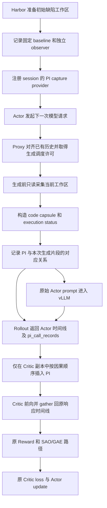

# Repair-state PI v2：设计、数据流与接入实现

文档日期：2026-10-21。实验：`pi_repair_state_v2_20261015`。训练 EXP：`sao-qwen35-9b-b64-pi-repair-state-v2-20261015`。

本文对照本独立副本的实际源码编写。运行逻辑以提交 `b05f087d951456778cc6eacf04a856a99a588fbf` 为基准；后续 `944f0dd` 只补充版本说明和测评汇总。本文不使用早期方案中已经撤回的“最后八层解冻”或“重新初始化 value head”。旧 1K 实验副本不属于本文的修改对象。

## 1. 当前方案的核心定义

当前 PI（Privileged Information，特权信息）是提供给 **Critic** 的、在每次模型生成之前采集的修复工作区摘要。它包含：

1. 任务初始缺陷代码到当前工作区的真实改动，包括修改前、修改后文本。
2. 与改动相关的有界静态代码上下文。
3. Actor 已经看到的最近完成工具结果的简短状态，以及当前已知调用和生成计数。

可以用下式表达设计意图：

$$
P_t = \operatorname{Serialize}\bigl(\Delta(B,W_t),\ C_t,\ E_{<t},\ K_t\bigr)
$$

其中：

| 记号 | 实际含义 |
|---|---|
| `B` | 任务准备完成、Actor 开始执行之前的 buggy baseline commit/tree |
| `W_t` | 第 `t` 次生成之前实际读到的当前任务工作区 |
| `Δ(B,W_t)` | 固定 baseline 到当前工作区的差异；不是仅上一动作造成的差异 |
| `C_t` | 改动所在符号的签名、同模块被引用的定义签名和相关 import |
| `E_<t` | 请求历史中已完成、已对 Actor 可见的工具观察 |
| `K_t` | 已完成模型调用数、累计生成 tokens、下一次输出上限等已知计数 |

这里的 `t` 指一次模型生成调用；一次调用可能同时生成多个 tool call。它不同于训练的 global step。

**这不是完整环境状态，也不是正确答案。** 采集范围是 Git 跟踪的差异和未忽略的新文件，不包括任意进程、内存、网络状态或完整文件系统。Actor 也可能通过正常工具逐步读到其中很多内容；特权主要在于训练侧直接取得并整理当前改动，让 Critic 不必仅从很长的交互历史中重建代码状态。

执行状态部分来自 Actor 已有观察，本身并不一定增加新的信息。它的作用是组织和显式标注已有证据，不能将其等同于一个额外 oracle。

## 2. 与 SAO baseline 和旧 1K 的关系

### 2.1 保持 baseline 的学习设定

| 项目 | 当前实现 |
|---|---|
| 基座模型 | 原 Qwen3.5-9B |
| Value head 初始化 | 原 baseline 初始化，没有清零权重或设置 0.5 bias |
| Critic 冻结模式 | `self_attn.`、`linear_attn.`、`visual.`，沿用 baseline；没有最后八层额外解冻 |
| Actor / Critic 学习率 | `1e-6` / `5e-6` |
| Actor / Critic PPO epochs | `1` / `2` |
| Batch / minibatch | `64` / `64` |
| Rollout workers | `32` |
| 序列并行 / 数据并行 | `SP8 / DP1` |
| Critic warmup | global step1–19 只更新 Critic；step20 首次更新 Actor |
| Critic LR warmup / 梯度裁剪 | `10` steps / `10` |
| Value loss | 原 clipped value MSE，`cliprange_value=0.5`，`token-mean` |
| Reward、轨迹过滤、SAO、GAE | 沿用 baseline；没有额外 reward shaping 或辅助损失 |
| Actor rollout 参数 | 沿用原训练配方；PI 不加入 Actor prompt |
| 数据 | 6248 个训练任务，1 epoch，97 个完整 batch steps |

Actor 的优势仍由原 SAO/GAE 路径计算。**保持 GAE 公式不变不代表优势数值不变**：PI 改变 Critic 的 value 预测，因而可以通过优势估计间接影响 Actor 的后续梯度。这正是该方案影响策略学习的通路。

### 2.2 不能称为仅替换文本的单因素实验

相对旧 1K，这版同时改变了 PI 的内容、表示形式、单状态预算、代码/状态分离去重和总 PI 预算处理，还保留了采集、历史对齐、checkpoint 和审计工程。

因此准确说法是：**在尽量保持 SAO 学习配方一致的条件下，对照一套新的 PI 方案**。不能声称与旧 1K 只有几句 PI 文本不同，也不能声称所有历史 baseline 运行时环境已得到完全追溯。

来源：[正式配置](../scripts/train/configs/sao_b64_pi_repair_state_v2_20261015.env)、[源码对照审计](../SOURCE_COMPARISON_AUDIT_20261015.json)。`TRAINABLE_SPEC.json` 和 `IMPLEMENTATION_REPORT.md` 中部分“尚未启动/待验证”字段属于 10月15日的历史记录，不能作为当前运行状态。

## 3. 从任务环境到优化器的总体数据流



图中是逻辑数据流。实际 proxy 先完成 PI 采集，再调用 vLLM 生成；PI 没有被拼进发给 vLLM 的 `prompt_ids`。Critic 推理和 Critic 更新都调用同一个 PI builder。

## 4. 生成前的工作区采集

实现：[container_capture.py](../src/harbor_patch/privileged_state/container_capture.py)、[remote_docker.py](../src/harbor_patch/environments/remote_docker.py)、[registry.py](../src/harbor_patch/privileged_state/registry.py)。

### 4.1 固定初始缺陷 baseline

Harbor 的任务生命周期在环境准备完成后调用环境的 `initialize_privileged_state()`。环境记录：

- 工作区根目录 `repo_root`。
- 当时的 `baseline_sha`。
- 初始工作区是否干净；如果 dirty，拒绝把它当作准备完成的 baseline。
- 独立 baseline observer 的路径。

随后用 `session_id` 注册一个异步 capture provider。之后每次采集都使用最初记录的 baseline，不跟随 Actor 后续创建的 commit 或新 `HEAD`。

独立 observer 只保存该 prepared commit 及其 tree/blobs，不保留祖先历史或参考修复。它通过打包复制对象，避免依赖 Actor 可以删除的原 `.git` 对象。

正常情况下仍使用任务原 Git；当明确发现 baseline 对象丢失或已不再是 Git 仓库，才验证 observer 的固定工作区根目录和 baseline SHA，并用 observer 对比**当前真实工作树**。它不恢复 Actor 的 `.git`，也不把旧工作区当作当前状态。其他 Git 错误、身份不符或 observer 损坏继续报错。

### 4.2 采集哪些文件

`_collect_once()` 主要读取：

```text
git diff --name-only <fixed baseline> --
git ls-files --others --exclude-standard
```

路径去重、排序后，对每个变化文件读取 baseline blob 和当前内容，记录相对路径、状态、类型、当前内容 SHA256，以及适用的文件模式和大小。

| 文件情况 | 表示方式 |
|---|---|
| 文本修改 | `modified`，保留 old/current 两份文本 |
| 新文件 | `added`，old 文本为空 |
| 删除文件 | `removed`，current 文本为空 |
| 二进制、符号链接、非普通文件 | 显式记录类型，后续不假装有可用源码 |
| Git ignore 的未跟踪文件 | 不在这份差异快照范围内 |

拒绝绝对路径、`..`、`.git` 路径以及通过符号链接祖先逃出工作树的路径。采集不运行任务测试、不请求 LLM、不调用语义检索器。

### 4.3 一致性检查与字节上限

当前限制为单文件 `2 MiB`、读取的 old/current 总字节 `16 MiB`。超过限制直接失败，不把不完整内容冒充完整快照。

采集会检查单文件读取前后的 size、mtime、ctime，并在结束后重新核对变化路径集合。检测到并发变化或文件消失时，丢弃整次采集，最多重新采集 5 次，重试间隔 0.05 秒。其他错误不一律重试。

**源码明确记录 `atomic=False`。** 这些检查提高一致性，但没有锁住整个工作区，也没有对所有文件做一个文件系统级原子事务；不能宣称取得了完整、原子的 Markov state。所有成功采集必须在这次生成开始前完成。

## 5. 代码 PI：如何把差异变成可读的修复状态

实现：[repair_state.py](../src/harbor_patch/privileged_state/repair_state.py) 的 `build_snapshot()`、`units()`、`_fit_units()`、`serialize()`。

### 5.1 状态标识和相对版本

`build_snapshot()` 对固定 baseline 和排序后的文件身份信息生成 `state_hash`。原始源码字符串不直接放进这一层身份字典，但采集元数据中已有当前内容摘要；实际序列化仍使用保存的 old/current 原文。

每个 session 的 `repair_pi.versions` 给首次遇到的状态分配局部编号，例如 `v1`、`v2`。编号表示“这份状态的标识”，不是训练 step，也不一定随时间严格增长：返回之前见过的状态可以重新使用原编号。

完整 hash、绝对路径、时间戳和采集重试信息保留在审计元数据中，不作为长串标识写入 Critic 的 PI 正文。

### 5.2 差异 hunk

`units()` 使用 `difflib.SequenceMatcher(..., autojunk=False)`，以 3 行上下文生成分组 hunk：

```text
FILE "pkg/module.py" status=modified
@@ old 10:15 current 10:15 @@
 unchanged context
-old code
+current code
 unchanged context
```

这里的 `-` 明确是 baseline 中的文本，`+` 是当前工作区文本，避免把删除内容误当成正在执行的代码。

注意：虽然继承的环境配置中有 `PI_DIFF_CONTEXT_LINES=20`，**v2 当前的实际 hunk 分组写的是固定 3 行**；不能据此配置声称 v2 使用了 20 行上下文。当前代码也没有把改动转换成“正确/错误”或“进展百分比”。

### 5.3 静态局部上下文

对可解析的当前 Python 文件，`units()` 用标准库 `ast` 找到：

- 改动所在函数、异步函数或类的签名。
- 改动行中引用、且在同模块顶层定义的函数或类签名。
- 与改动行引用名称有关的顶层 import。

签名使用源码原文，最多取定义起点之后约 6 行的范围。上下文在文件内去重；没有跨模块递归调用图、运行时追踪、外部检索或额外 LLM 总结。

Python 解析失败时，保留可用差异并增加 `parse_errors`，不把“语法可以解析”当作“修复正确”。非 Python 文本仍可产生差异，但不走这套 Python AST 上下文。

### 5.4 排序、恢复和截断

与上一次观察相比，新增或变化的文件优先进入排序，之后按路径排序；各文件 hunk 按轮转方式分配预算，减少单文件独占全部空间。

如果之前的变化文件现在不再出现在 baseline 差异中，会产生：

```text
REVERTED "pkg/module.py": current equals prepared baseline
```

这是显式恢复信号。历史 PI 仍留在序列里，新的 code capsule 用 `supersedes earlier code state` 说明当前状态已取代此前描述。

优先保留完整 hunk/上下文单元。放不下时，可保留带范围头的整行前缀并标记 `[PARTIAL UNIT: remaining lines omitted]`；超过 256 tokens 的长源码行在这条部分保留路径中用 `[LONG SOURCE LINE OMITTED]` 表示。还会统计遗漏单元、部分单元和遗漏上下文数量。不能把没有写出的代码视为不存在。

## 6. 执行证据 PI：来源、字段及限制

实现：`repair_state.py::completed_evidence()`。

### 6.1 证据来源

Proxy 在当前请求的 messages 中识别已完成的 `role=tool` 消息，通过 `tool_call_id` 对应 assistant 的工具调用。每条工具消息按完整消息 digest 去重，追加到 session 内的 journal。

未返回结果的 pending tool call 不产生完成证据。用户消息中写的“测试通过”、未来 verifier 输出，以及本次动作执行后才出现的结果，都不会被回填到之前的 PI。

journal 保存精确事件引用；Critic 正文只取得一个短状态行，不会把全部工具输出再次完整复制进去。

### 6.2 退出码和测试摘要

- 只有工具结果 JSON 中明确的整数 `exit_code` 或 `return_code` 才被当作退出码，布尔值不算整数退出码。
- 普通文本中的 `exit_code: 0`、命令回显或异常堆栈，不会被猜成成功退出。
- 当工具参数包含 `pytest` 或 `test`，且输出中出现 `N passed/failed/errors/skipped/xfailed/xpassed` 等文本时，记录最后若干条摘要。
- 摘要是已执行工具的报告，不是 Harbor 的最终 reward 或隐藏测试结论。

SDK 参数可能已经是 dict。当前实现只把参数转换成一个只读 JSON 搜索视图来识别测试命令，**不会为此修改 Actor 消息或它的身份 hash**。这覆盖了早期将 dict 直接传入正则表达式而失败的输入。

### 6.3 新鲜度为何经常是 unknown

当前没有“工具真正执行边界”的工作区快照，只有“下一次生成之前看到工具结果时”的工作区。因此：

| 情况 | 标注 |
|---|---|
| 首次读到已完成工具结果 | `freshness=unknown` |
| 当前代码 hash 与该结果被观察时的 hash 不同 | `freshness=stale` |
| 最近测试摘要的观察 hash 与当前不同 | `test_freshness=stale` |
| hash 相同 | 仍为 `unknown`，不升级成已经证明 fresh |

这份状态是保守证据，不是带准确执行版本绑定的测试状态。此前内容审计中大量退出码为 unknown，与这个严格解析及 SDK 输出格式有关，不能直接解读成命令真的没有退出。

### 6.4 Critic 实际看到的状态行

```text
[EXEC observed_code=v2 status=completed_observation exit=unknown freshness=unknown calls_completed=8 generated_tokens=2310 next_output_limit=4096 test_report=2 passed test_freshness=unknown]
```

`calls_completed` 是已完成的模型生成调用数，不等于 shell 命令数；`generated_tokens` 是 session 累计生成 token 数；`next_output_limit` 来自本次采样参数。当前并没有一个独立、精确的环境剩余预算估计器。

状态行超过预算时使用更短的显式 `omitted=true` 形式，而不是猜测缺失字段。

## 7. 每次调用如何采集并关联原始生成

实现：[vllm_chat_completion_proxy.py](../src/verl_patch/agent_loop/vllm_chat_completion_proxy.py)。

### 7.1 生成前

1. 按原 proxy 逻辑计算/重建 Actor 的 `prompt_ids`。
2. 等待 session scheduler 的生成许可。
3. 调用 `registry.capture(session_id)` 读取当前工作区。
4. 调用 `repair_state.serialize()` 构造 code/status 两部分。
5. 保存 `pi_pending_record`，记录 `logical_call_id`、生成片段开始位置及采集元数据。
6. 使用原 `prompt_ids` 和原 sampling parameters 调用 `server_manager.generate()`。

这里的“pre-generation”是相对于采样动作的时间界限：采集先于本次生成，而不是等整条轨迹完成后回看代码再构造历史 PI。

### 7.2 生成后

`_finalize_generation()` 用实际生成 tokens 的长度补齐 `actor_response_end_abs`，再将 pending record 写入 `pi_call_records`。没有有效生成 tokens 或已禁用代理时间线时，不会把它当作一段正常动作记录追加。

回复消息经过原模板规范化后，proxy 保存该 assistant 消息的完整 `message_key`，用于下一次 SDK 历史重建时找回对应的生成前 PI。

### 7.3 主要记录字段

| 字段 | 用途 |
|---|---|
| `state_hash` / `code_state_hash` | 工作区状态身份 |
| `pi_insertion_key` / `logical_call_id` | 一次逻辑生成身份；处理一条回复被拆成多段的去重 |
| `code_version` | session 局部代码状态编号 |
| `code_ids` / `execution_ids` | 两部分分别编码后的 token 序列 |
| `pi_ids` / `pi_text` | 完整单次 PI 表示及审计文本 |
| `actor_response_start_abs` / `actor_response_end_abs` | 原 Actor token 时间线中的生成区间 `[start,end)` |
| `message_key` | 规范化 assistant 消息的完整 SHA256 |
| `execution_evidence` | 已完成工具观察的结构化来源和新鲜度 |
| capture 时间、attempts、retry errors | 审计和排错，不是额外的修复质量标签 |

## 8. SDK 历史重建、别名与多工具拆分

实现：[privileged_critic_builder.py](../src/verl_patch/agent_loop/privileged_critic_builder.py) 的前半部分。

### 8.1 为什么需要额外映射

SDK 下一次提交的历史不保证和上一次生成出来的消息对象完全一致。历史可能被重建，工具名或参数表示可能变化，一条多工具回复也可能被拆成多条 assistant 消息。

PI 必须仍对应“当时那次生成之前”的状态。不能因为看到当前工作区，就重新采集一份 PI 贴到旧动作之前；那会引入未来信息。

重建路径先从新历史得到 assistant token spans，再调用 `remap_rebuilt_records()`，按原记录的单调顺序匹配，重设 spans；PI payload 和逻辑生成身份沿用原记录。

### 8.2 当前允许的已观察表示变化

| SDK 历史中的表示 | 尝试恢复的原表示 |
|---|---|
| `terminal`，且参数含字符串 command | 工具名 `command` |
| `file_editor` 的 view，`view_range` 为两个整数的 list | 原来的 JSON string 表示 |
| `file_editor`，`command=str_replace` | 原工具名 `str_replace` |
| 上一行同时多出了 command discriminator | 原工具名 `str_replace`，并去掉 SDK 插入的这一特定字段 |

`_sdk_original_variants()` 只枚举这些已知形式，且最多处理一条消息中 4 个 tool calls 的别名组合。**能枚举出来并不代表接受**：候选必须恢复到记录里的原完整消息 SHA，且对应唯一，才允许建立别名。

未知参数变化、正文变化、tool ID 变化、调用顺序变化或多个可能对应，都不会通过模糊相似度放行。

### 8.3 一条多工具回复被拆成多条

`_expand_verified_tool_splits()` 要求：

- 原消息身份可以唯一确认。
- 原 tool IDs 都有效且唯一。
- 新片段是原 tool calls 的完整、有序分区。
- 第一片段 content 与原消息完全相同，后续片段 content 为空。
- 其他字段完全相同；若片段带已知别名，必须先精确恢复到预期切片。
- 缺片段、改参数、重排序、重复/歧义分区全部失败。

通过后，每个片段继承**同一次原 pre-generation PI 和 logical call**，增加 `verified_tool_split_index/count` 等审计字段。插入阶段依靠相同 insertion key，避免一个原动作的 PI 被重复塞入多次。

### 8.4 实际发生过的失败与补充支持

| 位置 | 新遇到的表示 | 处理原则 |
|---|---|---|
| step32 Paramiko | view_range string/list、工具名变换 | 逆向恢复后用原完整 SHA 证明 |
| step47 Radon | `str_replace→file_editor` 加上插入 command 字段 | 同时恢复工具名和特定 discriminator，仍要求唯一完整 SHA |
| 从40恢复后的 step42 Typeguard | 多工具拆分叠加 `command→terminal` | 对每个有序片段做精确别名恢复，再证明完整分区 |

这些故障暴露了 PI 映射层对 SDK 表示规则的覆盖不完整。当前修复保留严格匹配，不意味着所有未来 SDK 改写都已覆盖。一个新随机运行顺利经过同一训练 step，也不能替代对原失败输入的精确回放证明。

## 9. PI 如何进入 Critic，而不进入 Actor

### 9.1 两份输入视图

Rollout 输出保留原 `prompt_ids`、`response_ids`、`response_mask`、生成 logprobs，并在 `extra_fields` 中附带 `pi_call_records`。

Trainer 的 `_compute_values()` 和 `_update_critic()` 都把 batch 转成用于本次调用的 TensorDict，再调用 `prepare_critic_view()`。它只替换 Critic 副本的模型输入，并建立 gather 映射。

Actor 更新、原策略 logprob 和 reference logprob 路径会移除 `pi_call_records`，使用原 Actor 时间线。这里“不改 Actor”指 PI 接入不更改其输入和采样规则；不是说不同训练版本会生成逐位相同的随机轨迹。

### 9.2 序列布局与两层去重

```text
Actor:   [prompt] [A1 sampled tokens] [tool observations] [A2 sampled tokens] ...
Critic:  [prompt] [PI1] [A1 tokens] [tool observations] [PI2] [A2 tokens] ...
```

`interleave()` 遍历原 Actor token 序列，只在对应生成片段的起点加入 PI。移除 Critic 中标记为 PI 的 tokens，应能还原原 Actor token 序列。

实际有两层去重：

1. 相邻记录的 `pi_insertion_key` 相同：属于同一次逻辑调用的拆分片段，不再次插入。
2. 新逻辑调用的代码 hash 与上一次相同：只插 execution status，不重复 code capsule；代码变化时重新插入 code/status。

代码从 A 变成 B 再变回 A，由于与上一状态 B 不同，会再次插入 A 的代码表示。它不是“全轨迹见过一次就永久省略”的去重。

历史 PI 一直保留在因果前缀中。当前方案没有删除旧 PI，也没有额外的“只能关注最新状态”attention mask；`supersedes` 是文本约定，模型仍可能读到旧状态。

### 9.3 每个动作 token 的 pre-token value 对齐

PI 不是只为每次工具调用产生一个 value。Critic 仍为原 sampled action token 时间线提供 value。

当遍历到原响应 token `x_j` 时，先插入这次调用的 PI，再记录：

```python
mapping[j] = len(critic_prefix) - 1
critic_prefix.append(x_j)
```

因此 `mapping[j]` 指向的是**消费当前动作 token 之前**的最后一个上下文位置。

- 一次生成的首 token：value 可看到这次生成前 PI，但看不到首 token 自己。
- 同一生成片段的后续 token：value 可看到之前已生成 tokens 和该片段的 PI。
- 下一轮动作：可看到已完成工具观察和下一次 pre-generation PI。
- 后面调用采集的 PI 位于后面，不出现在 earlier value 的因果前缀里。

`prepare_critic_view()` 生成 `critic_value_gather_indices`、`critic_pi_mask`、新的 attention/position IDs，然后走原无 padding/packing 路径。padding overlay 发现 gather indices 后调用 `gather_critic_values()`，将 packed 全序列输出恢复成原 `[batch, response_width]` value 形状。

实现：[builder](../src/verl_patch/agent_loop/privileged_critic_builder.py)、[padding overlay](../vendor_overrides/third_party/verl/verl/workers/utils/padding.py)、[trainer overlay](../vendor_overrides/third_party/verl/verl/trainer/ppo/ray_trainer.py)。

### 9.4 loss mask 和梯度

`response_mask` 仍以 Actor 原时间线为准：sampled assistant token 是动作，工具观察等非动作位置不增加 action loss。PI tokens 不加入 reward、response mask 或 loss 分母。

这不等于“PI 没有梯度作用”：原动作位置的 value 可以依赖前面的 PI，因此 value loss 能沿 Critic 的上下文计算路径传播到可训练参数。当前没有额外 PI 预测 loss、PI 重建 loss、对比学习目标或独立 PI encoder。

## 10. token 预算与因果裁剪

### 10.1 单次表示预算

| 部分 | 上限，含相关格式 tokens |
|---|---:|
| 状态头、覆盖统计和结束标记 | 128 |
| baseline→current diff | 1408 |
| 静态上下文 | 384 |
| code capsule 总计 | 1920 |
| execution status | 128 |
| 单次完整 PI 总计 | 2048 |

这些子预算当前在 `repair_state.serialize()` 中固定实现。配置的 `PI_MAX_TOKENS_PER_STATE=2048` 表达正式方案，但**只改这一个环境变量不会自动重分配 v2 的 1920/128 子预算**。

code 和 status 分别使用同一个模型 tokenizer 编码，`add_special_tokens=False`，然后拼接；没有为 PI 另训练 tokenizer 或加入新词表。

### 10.2 整条 Critic 轨迹预算

| 配置/推导 | 值 |
|---|---:|
| `PI_CRITIC_MAX_SEQ_TOKENS` | 245760 |
| `PI_ACTOR_RESERVED_TOKENS` | 73728 |
| 固定 PI 配额：两者之差 | 172032 |
| 正式开关 `PI_TOTAL_BUDGET_ENABLE` | 1 |

73728 对应正式保留的最大 Actor prompt8192 + response65536。这里的 response 时间线可包含工具观察；只有其动作 mask 部分承担动作 loss。

PI 配额从一开始固定，按时间顺序分配，并预留一个 exhaustion marker。**不会用最终轨迹长度或未来状态数量反过来压缩先前 PI**。

v2 在总配额不够容纳下一个待插入 PI 块时，不在 hunk 中任意切一段 token；它写入：

```text
[TRUNCATED_BY_TOTAL_PI_BUDGET: later PI omitted]
[PI EXHAUSTED: no later repair state represented]
```

随后省略更晚的 PI。原 Actor tokens 不为 PI 让位。Actor 超过固定保留长度或 Critic 超过安全长度时，直接报错。

因此，“每次有一份 PI 记录”不代表“每份 PI 正文都实际插入了最终 Critic 输入”。去重、响应窗口和总预算都要结合审计来判断。

## 11. 一个具体例子

假设初始文件为：

```python
def add_one(x):
    return x + 1
```

Actor 执行编辑后，下一次生成前工作区为：

```python
def add_one(x):
    return x + 2
```

PI 代码部分会表达为下面这种形式；行号和实际格式由 serializer 产生：

```text
[REPAIR_STATE v2: supersedes earlier code state; baseline->current]
files=1 reverted_files=0 omitted_units=0 partial_units=0 omitted_context=0 parse_errors=0
FILE "example.py" status=modified
@@ old 1:2 current 1:2 @@
 def add_one(x):
-    return x + 1
+    return x + 2
CONTEXT "example.py" current:1-1
def add_one(x):
[/REPAIR_STATE]
[EXEC observed_code=v2 status=completed_observation exit=unknown freshness=unknown ...]
```

这个 PI **只说明代码从什么变成了什么**，不宣称 `+2` 是正确修复。

如果下一轮只是查看文件、代码未变，code capsule 不重复，但新的 execution status 仍可插入。如果之后恢复成 baseline，下一份 capsule 明确表达 `REVERTED`，而不是继续把 `+2` 当作当前代码。

## 12. Reward、过滤和更新的接入顺序

### 12.1 训练数据流

训练主路径可以概括为：

```text
原 Actor rollout + pi_call_records
    → 原终局 reward / 原 logprob 处理
    → Critic PI view 推理，gather 回 Actor 时间线
    → 原轨迹过滤与 SAO/GAE，保留原 mask
    → 对过滤行清零优势的保护
    → 保存本批审计副本
    → 使用同一 PI builder 更新 Critic
    → 按原 warmup 规则决定是否更新 Actor
    → 按原正式周期保存 checkpoint
```

PI 不改变任务 verifier，也不把代码 diff、语法错误数或工具摘要转成额外 reward。真正的 terminal reward 仍来自原验证流程。

未知 verifier 结果与 PI 对齐失败是两种不同情况：

- verifier 未判分：走既有空轨迹/无效行和过滤保护，不能擅自当成一个正常的负样本。
- PI 采集或历史映射失败：session 记录 `pi_error`，agent loop 抛错，停止这次训练流程；不能用空 PI 或旧 PI 隐藏。

attempt 数包含原任务重试，可能多于64；batch/任务数仍按正式训练配方解释。PI raw attempt calls 也可能多于最终训练 batch 的 `pi/captured_calls`。

### 12.2 PI 影响学习的具体数学位置

把有效的 sampled action tokens 单独编号为 `j`，省略 batch 维度。令 `z_j` 为加入截至该位置的因果 PI 后、动作 token 之前的 Critic 前缀，则：

$$
V_j = V_\phi(z_j), \qquad
\delta_j = r_j + \gamma V_{j+1} - V_j.
$$

Actor 优势沿用原递推，示意为：

$$
\hat A_j = \delta_j + \gamma\lambda_{\rm policy}\hat A_{j+1},
\qquad
\lambda_{\rm policy}=1-\frac{1}{1.5\max(L,1)}.
$$

`L` 是原 response mask 中 sampled action tokens 的数量；不是包含工具输出和 PI 的完整 Critic 序列长度。当前 `gamma=1`，Actor 优势之后按原设置做 mask-aware whitening。实际代码在原响应时间线上跳过 observation mask 为0的位置，不在工具观察位置推进 next value 和 GAE 累积项。

Critic 的 target 使用独立 `lambda_critic=1` 路径生成 returns，不使用已经 whiten 的 Actor 优势来构造 target。Value 更新沿用原 clipped MSE：

$$
\widetilde V_j = \operatorname{clip}(V_j^{\rm new}, V_j^{\rm old}-0.5, V_j^{\rm old}+0.5),
$$

$$
\mathcal L_V = \frac12\operatorname{MaskedTokenMean}_j
\left[\max\big((V_j^{\rm new}-G_j)^2,(\widetilde V_j-G_j)^2\big)\right].
$$

公式中的 mask/归一化仍来自原 action loss timeline，PI tokens 不增加 `L` 或分母。`V_old` 来自优化前的 PI Critic 推理，`V_new` 来自更新时使用同一 builder 构造的 PI Critic 输入。PI 的直接改动点是 `z_j`；后续 value、优势和梯度的数值可以随之变化，但递推公式、训练目标和超参数没有因此增加新项。

这里描述的是本副本实际继承的 `compute_length_adaptive_lam()`、`compute_gae_advantage_return()` 和 `compute_value_loss()` 行为，不是新提出一套 GAE 算法。

## 13. 生命周期保护与 checkpoint 工程

### 13.1 已关闭环境的迟到请求

环境停止时注销 provider，并标记明确关闭的 session。迟到请求得到 `SessionClosedError`，对应 HTTP410，且在模型生成前拒绝；不因此把已关闭 session 记成真实 PI 采集损坏。

未知 session、活动 session 缺 provider、真实采集失败和未知历史改写仍 fail closed。没有“provider 不见了就返回最近一次 PI”的 fallback。

### 13.2 正式保存和恢复

- `PI_WARMUP_CHECKPOINT_STEPS` 正式为空，不保存 step5/10 warmup checkpoint。
- 正常从 step20 开始，每10步保存，最后一步也保存。
- 完整保存 Actor/Critic 的 model、optimizer、extra state，以及 dataloader state。
- 8 ranks 下 `PI_COMPLETE.json` 核验49项必需文件：48份 Actor/Critic model/optim/extra shards + `data.pt`。
- 完整标记记录 EXP、step、world size、PI format、source revision 和文件大小。
- 每次保存前保留至少200GiB空间；不足时等待，不降保存频率、不写部分 checkpoint、不自动删除资产。
- 恢复只能使用同 EXP 的完整 checkpoint；读取失败不能回退 fresh base。

完整标记及非空文件大小检查只证明清单和大小满足要求，**不等于所有 tensors 已逐项反序列化验证或 bitwise 复现**。历史分布式重复 update 的数值差异仍未完全解释，不能把“warmup 保存导致”当作已经证实的因果结论。

这些是工程保障，不属于新的 PI 学习目标。若失败发生在两个保存点之间，未保存的更新仍会丢失并在恢复后重算。

实现：[pi_checkpoint.py](../src/verl_patch/agent_loop/pi_checkpoint.py)、[pi_disk_guard.py](../src/verl_patch/agent_loop/pi_disk_guard.py)。

## 14. 可审计产物与验证范围

### 14.1 归档内容

| 产物 | 内容和用途 |
|---|---|
| `pi_baseline.json` | 初始 baseline 和采集身份 |
| `pi_calls.json` | 每次生成前的 PI、spans、message identity、异常 |
| `pi_exact_actor_timeline.json` | 精确 Actor IDs、mask、logprobs 和完成观察 journal |
| `proxy_trajectory.json` | proxy 看到的消息及轨迹记录 |
| `pi_batches/step_XXXX.pt` | 推理/优势计算之后、优化之前的实际 batch tensors、returns、行顺序和配置 |
| budget/PI metrics | token 数、状态变化、截断、解析失败和采集耗时 |

`pi_archive.archive_batch()` 克隆 tensors 到 CPU 后持久化，不对活跃 batch 做 in-place 更新；拒绝覆盖已有审计文件。gather 索引不单独持久化，用精确归档输入和对应版本 builder 重建。

这些本地日志、batch tensors 和原始轨迹不上传 GitHub，也不会再次输入 Actor 或用于未来 PI 采集。

### 14.2 已有验证能说明什么

已有 CPU 测试覆盖：before/after、预算、完整恢复、code/status 去重、未来状态不影响先前分配、工具观察新鲜度、Actor token 保留、pre-token mapping、未知改写拒绝、已知别名及拆分组合、baseline observer、session410 等。

补充的真实失败 proxy/Qwen tokenizer CPU 回放验证了原 Paramiko/Radon/Typeguard 输入的映射及 Actor IDs、mask、logprobs、routing、PI payload 的保持。历史归档等价回放检查的是已保存输入，不是对所有未来输入的证明。

真实 Harbor 集成探针有真实容器、tokenizer、proxy 和工具执行，但模型输出是 scripted generation，也不运行任务 verifier；它不等于新的 GPU 神经网络数值验收。另有8GPU短合成更新通过的历史证据，其范围也不等于最大长度压力测试或效果保证。

训练已实际进行到并完整保存 checkpoint50，随后按用户要求停止并测评。此前同类历史映射故障是明确退出的正确性保护，同时说明适配规则仍有覆盖边界。

### 14.3 目前效果证据

完整数据见 [evaluation_summary_20261021.json](../results/evaluation_summary_20261021.json)。

| Checkpoint | 原始通过 / 500 | 用户要求的异常题复测替换后 / 500 |
|---|---:|---:|
| 20 | 274，54.8% | 277，55.4% |
| 30 | 285，57.0% | 286，57.2% |
| 40 | 280，56.0% | 281，56.2% |
| 50 | 278，55.6% | 279，55.8% |

复测替换采用全部指定异常题的新判分，不重复加已经通过的题；原结果文件不变。该汇总混合了不同并发和随机轨迹，不是统一条件的整套500题重测。原 step30/50 各有1题未判分，原运行和 baseline 都存在异常/超时限制。

当前不能根据这些结果宣称 PI 优于 SAO。代码接入正确性、Critic 是否实际利用 PI，以及 PI 对策略表现的增益，是三个不同问题。

## 15. 已知边界与后续分析时应避免的误读

1. **工作区差异是修复状态的一部分。** 不等于完整环境状态，不直接知道 bug 是否解决。
2. **2048 tokens 会遗漏内容。** 保留覆盖标记，但无法保证大改动中最关键的代码一定入选。
3. **执行行可能冗余且缺乏准确语义。** `unknown`、测试摘要和计数不能替代真实执行版本绑定；不应默认它们都有强预测信息。
4. **重复代码省略不是删除历史。** Critic 仍需从多个 code capsules 和 supersedes 文本中识别当前状态。
5. **PI 不带额外监督。** 现有 value loss 没有强制模型关注 code block；输入存在不代表 Critic 已经学会利用。
6. **历史匹配仍是 SDK 适配边界。** 已知别名可严格证明，未知新表示仍可能停训；不能为了少停机改成任意相似度匹配。
7. **长序列有真实成本。** Actor rollout 本身不读取 PI，但采集、Critic 长上下文和审计写盘都会增加工程开销。
8. **训练 EV 与评测改善不能互相替代。** EV 应看同阶段多步趋势；随机不同轨迹下的跨 run 比较不构成受控消融。
9. **当前停止状态不由本文改变。** 本文是实现说明，不是重新训练、重新部署或再次测评的操作授权。

## 16. 阅读源码的推荐顺序

| 顺序 | 文件 / 入口 | 重点 |
|---|---|---|
| 1 | [正式 env](../scripts/train/configs/sao_b64_pi_repair_state_v2_20261015.env) | 当前方案、预算、保存/恢复开关 |
| 2 | [container_capture.py](../src/harbor_patch/privileged_state/container_capture.py) | 固定 baseline、实际文件读取、observer 和一致性边界 |
| 3 | [repair_state.py](../src/harbor_patch/privileged_state/repair_state.py) | code capsule、静态上下文、执行证据和单次预算 |
| 4 | [registry.py](../src/harbor_patch/privileged_state/registry.py) / [remote_docker.py](../src/harbor_patch/environments/remote_docker.py) | provider 注册、容器采集和关闭会话 |
| 5 | [vllm_chat_completion_proxy.py](../src/verl_patch/agent_loop/vllm_chat_completion_proxy.py) | 生成前采集、生成后 spans 和历史重建 |
| 6 | [privileged_critic_builder.py](../src/verl_patch/agent_loop/privileged_critic_builder.py) | 别名/拆分证明、PI interleave、总预算、pre-token gather |
| 7 | [builtin_swe_agent_loop.py](../src/verl_patch/agent_loop/builtin_swe_agent_loop.py) | rollout 输出携带 PI records、错误传播和无效行 |
| 8 | [ray_trainer.py overlay](../vendor_overrides/third_party/verl/verl/trainer/ppo/ray_trainer.py) / [padding.py overlay](../vendor_overrides/third_party/verl/verl/workers/utils/padding.py) | value 推理/训练共用 builder，以及回到原时间线 |
| 9 | [pi_archive.py](../src/verl_patch/agent_loop/pi_archive.py) / [pi_checkpoint.py](../src/verl_patch/agent_loop/pi_checkpoint.py) | 审计与持久化工程 |
| 10 | [v2 tests](../tests/test_repair_state_v2.py)、[alias tests](../tests/test_pi_sdk_proven_alias.py)、[split-alias tests](../tests/test_pi_split_alias.py) | 因果、不变性和拒绝错误输入的具体用例 |

Git 分支只包含应用源码和 PI-specific overlays，并不包含整个私有 runtime、共享 venv、模型或数据。仅克隆 GitHub 仓库不等于已经具备可直接训练的完整环境；重建边界见 [VERSIONING.md](../VERSIONING.md)。
